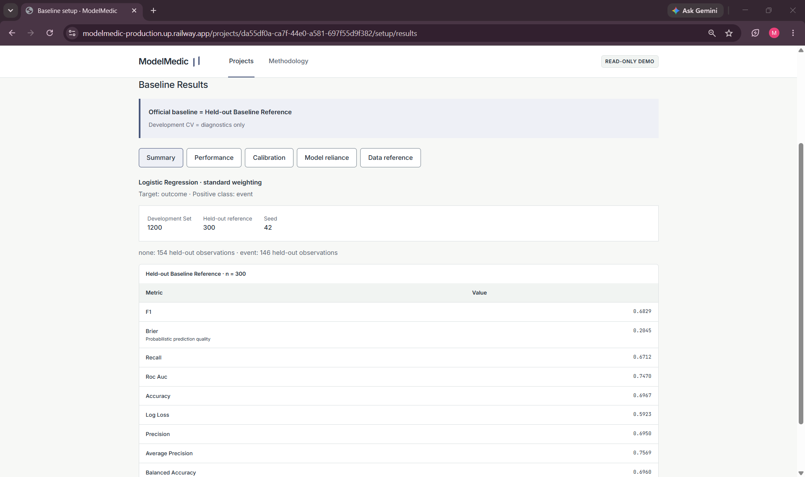
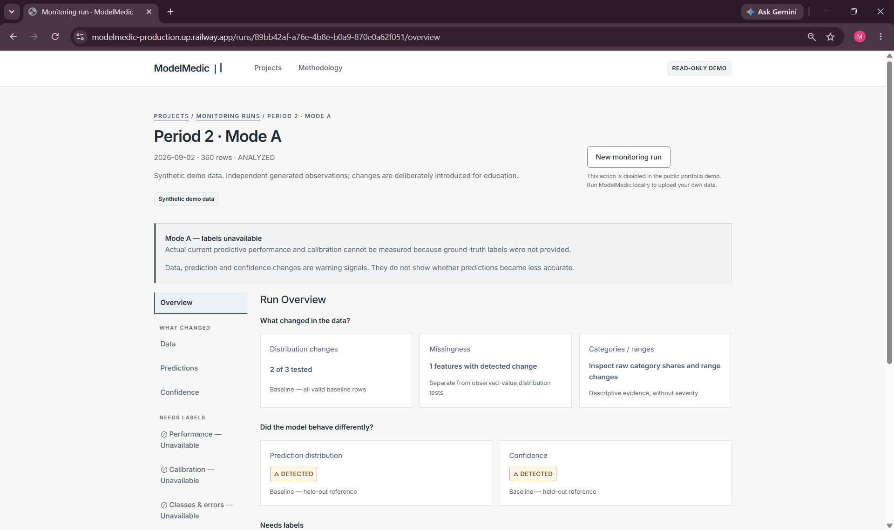
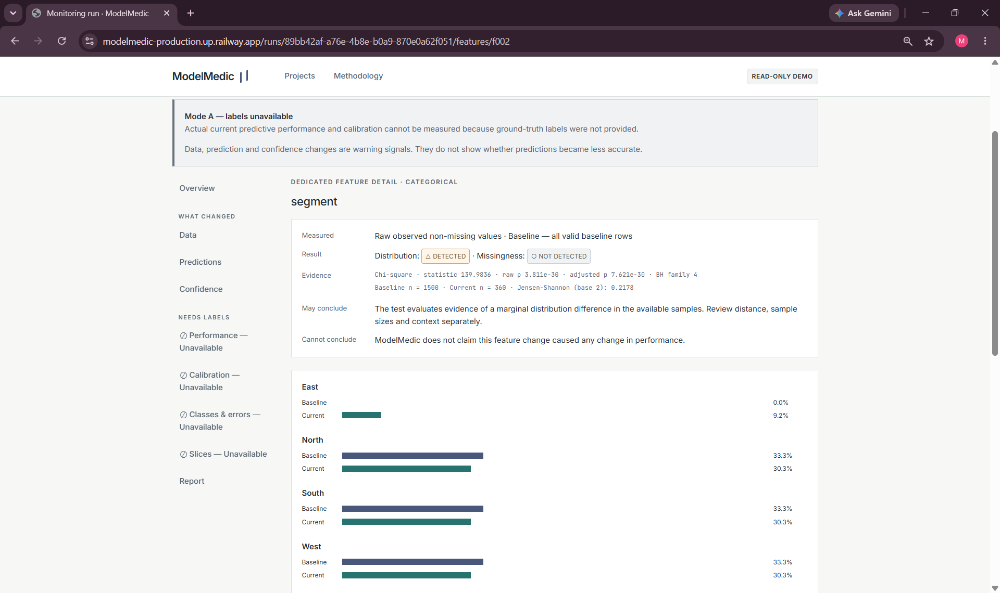
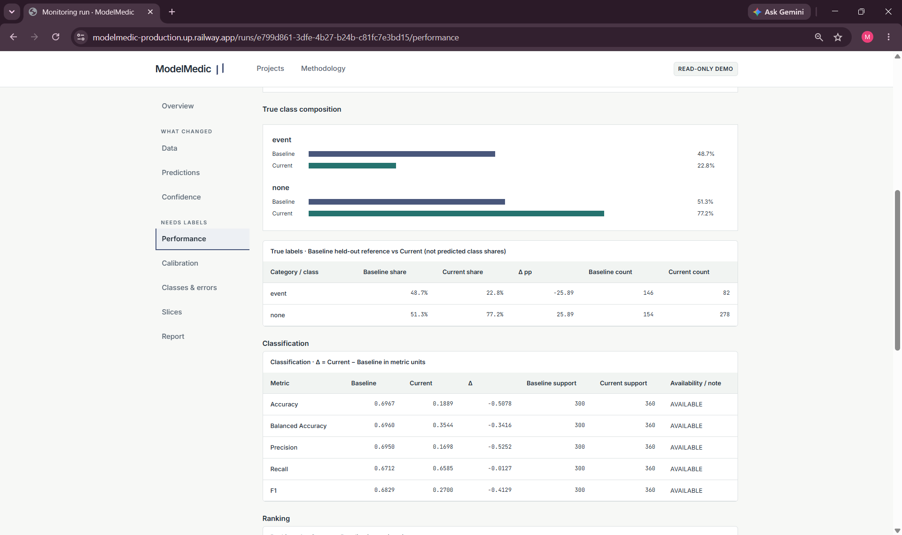
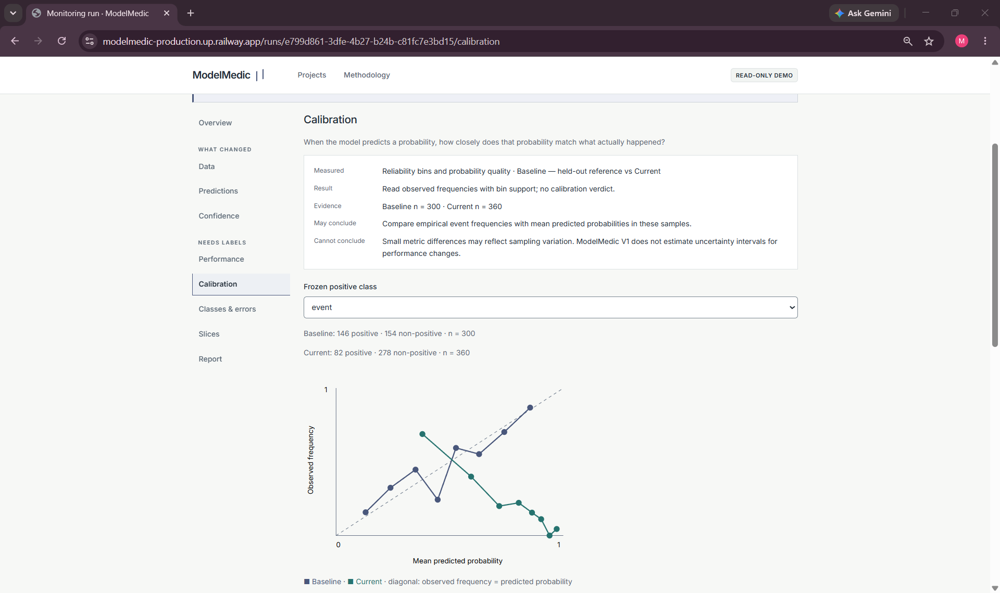
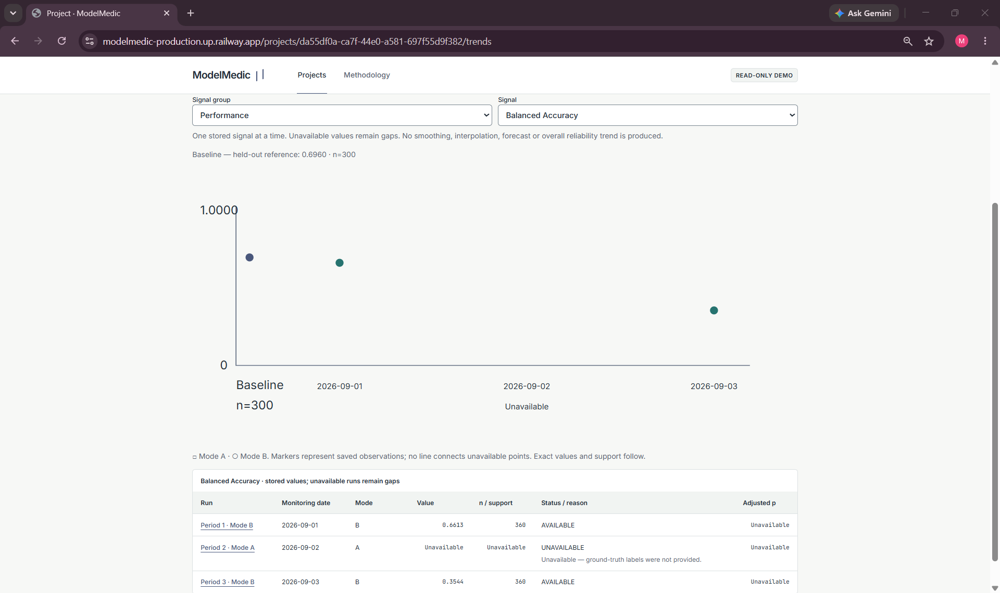
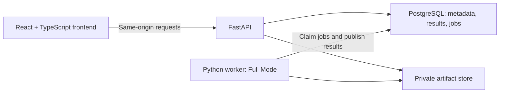

# ModelMedic

**ML reliability and drift analysis for tabular classification systems.**

ModelMedic helps you investigate whether a classifier behaves differently on newer
data. Establish a reproducible baseline, freeze its preprocessing and model, then
compare later datasets with that reference. It separates changes in inputs,
predictions and confidence from changes in measured performance—and makes clear
which conclusions require labels.

**[Explore the live demo](https://modelmedic-production.up.railway.app/projects)** ·
[Methodology](docs/methodology.md) ·
[Engineering evidence](docs/m7-verification.md)

The public demo is **read-only**, uses deterministic synthetic data, and shows
saved results from the real validation, training and analysis pipeline.

## Why ModelMedic?

A model can keep returning predictions while its inputs, confidence, calibration
or actual performance changes. ModelMedic puts these signals side by side, with
sample counts and explicit limitations. Changed inputs alone do not prove worse
predictions, and reliability is not reduced to a single health score.

## What it does

- **Establish a baseline:** validate a CSV, review features and preprocessing,
  select a classifier and weighting, explicitly train, then freeze the baseline.
- **Analyze later data:** inspect drift, missingness, predictions and confidence;
  add performance, calibration, class/error diagnostics and slices when labels exist.
- **Keep the evidence:** revisit saved diagnostics, trends and deterministic
  reliability reports, with table alternatives and Print / Save as PDF.

| Monitoring mode | Evidence available |
|---|---|
| **Mode A — no labels** | Data drift, missingness, prediction-distribution and confidence changes. **Current predictive performance and calibration cannot be measured.** |
| **Mode B — complete, valid labels** | All Mode A evidence, plus baseline/current performance, calibration, class/error diagnostics and exploratory slices. |

Partial labels and unknown classes block validation; they are not silently treated
as Mode A. Neither mode refits preprocessing or retrains the established model.

## Demo workflow

Open **Synthetic reliability lab** in the
[live demo](https://modelmedic-production.up.railway.app/projects):

1. **Baseline Results:** held-out evaluation, calibration and model reliance.
2. **Period 2 / Mode A:** Data, Feature Detail, Predictions and Confidence;
   label-dependent pages explain why performance evidence is unavailable.
3. **Period 3 / Mode B:** Performance, Calibration, Classes & Errors and saved Slices.
4. **Trends / Reliability Report:** saved observations and their interpretation limits.

The **B–A–B** sequence means labeled, unlabeled, labeled. Performance trends keep
a gap for the middle period; they do not invent or interpolate missing evidence.
All displayed results come from real worker jobs on deterministic synthetic data.

The server limits public access to approved synthetic reads and blocks uploads,
training, analysis and deletion. Use local Full Mode for your own CSV files.

## Screenshots

| Baseline Results | Mode A — Unlabeled Monitoring |
| :---: | :---: |
| [](docs/assets/modelmedic/01-baseline-results.png)<br>Frozen baseline, held-out evaluation and reproducible reference settings. | [](docs/assets/modelmedic/02-mode-a-overview.png)<br>Drift and model behavior evidence; current performance requires labels. |
| **Feature Detail**<br>[](docs/assets/modelmedic/03-feature-detail.png)<br>Detected categorical drift, adjusted p-values, sample counts and distributions. | **Mode B — Performance**<br>[](docs/assets/modelmedic/04-mode-b-performance.png)<br>Separate baseline/current metrics with outcome support counts. |
| **Calibration**<br>[](docs/assets/modelmedic/05-calibration.png)<br>Baseline/current calibration, observed frequencies and sample support. | **Trends — Preserved Mode A Gap**<br>[](docs/assets/modelmedic/06-trends.png)<br>Balanced Accuracy keeps the unlabeled Mode A period unavailable. |

## System architecture

The API handles uploads, configuration and retrieval; a dedicated Python worker
runs validation and scientific computation outside HTTP requests. PostgreSQL
stores metadata, immutable results and the job queue. CSV, canonical Parquet,
model and reference artifacts stay in private storage.



The API and worker share one backend codebase and image. Queue claims use
`SKIP LOCKED`; leases, heartbeats and ownership checks prevent stale workers from
publishing results. Completion and result publication share a transaction.

Local Compose runs frontend, API, worker and PostgreSQL with a private artifact
volume. Production serves the built React assets and API from **one origin** on
Railway, with managed PostgreSQL and private S3-compatible storage. The public
read-only demo needs no running worker after private seeding. GitHub Actions
verifies the source and full container stack; see
[production operations](docs/m7-operations.md) for deployment details.

## Reliability methodology

- **Independent evaluation:** an 80/20 stratified Development/Heldout split with
  seed 42; five-fold CV fits preprocessing within each development fold.
- **Explicit model choice:** Logistic Regression, Random Forest or Gradient
  Boosting, with Standard or Balanced weighting and fixed settings.
- **Frozen reference:** monitoring never refits preprocessing or the model.
  Behavior comparisons use the held-out reference; raw feature and missingness
  comparisons use all valid baseline rows.
- **Separate statistical evidence:** numeric/categorical feature drift and
  missingness tests share a within-run Benjamini–Hochberg FDR correction.
  Statistical significance does not establish practical impact or causality.

**Mode A cannot establish performance degradation.** Mode B adds labeled
performance, calibration and error evidence, with support and availability reasons.
Exact tests, thresholds, calibration and reliance rules are in
[Methodology](docs/methodology.md) and the [scientific audit](docs/m7-scientific-audit.md).

## Tech stack

| Area | Technologies |
|---|---|
| Frontend | React 19, TypeScript, Vite, React Router, TanStack Query |
| Backend | Python 3.12, FastAPI, Pydantic, SQLAlchemy 2, Alembic |
| Data / ML | scikit-learn, NumPy, SciPy, pandas, PyArrow / Parquet, joblib |
| Database / queue | PostgreSQL 17, psycopg, PostgreSQL-backed leased jobs |
| Storage | Private local Docker volume; private S3-compatible store via boto3 in production |
| Infrastructure | Docker, Compose, Railway |
| Testing / CI | pytest, Vitest, Testing Library, Ruff, mypy, ESLint, TypeScript checks, GitHub Actions |

## Engineering and verification

M0–M7 are complete. Verification recorded on **2026-10-14** includes:

- **194 backend tests** = 131 unit/scientific + 63 real PostgreSQL integration.
  The native 131-test replay and additional 63-test PostgreSQL run repeat these
  suites; they are not extra unique tests.
- **47 frontend tests**, lint/type checks, production build, Ruff/formatting/mypy.
- **Full M0–M7 Compose gate:** all 12 target/classifier/weighting combinations,
  monitoring, slices, reports and restart persistence.
- **180 prohibited Demo method/route pairs denied**, seeded read scoping and fail-closed checks.
- **Zero npm audit vulnerabilities at M7 verification**, a dated audit result.

All four CI jobs—backend, PostgreSQL, frontend and system—passed on the final M7 commit.
[Exact-commit CI run](https://github.com/manthan3502/ModelMedic/actions/runs/38594272265) ·
[Verification record](docs/m7-verification.md)

The current public web image was cleanly rebuilt and redeployed from M7 commit
`27e5b8c0709f0ba448232e1675ceff85191af77e`. The post-redeploy public smoke passed:
HTTPS UI/deep links, the B–A–B gap, all 180 denied method/route pairs and persisted
fingerprints. Immutable seeded demo results retain their original
pre-commit/dirty-candidate provenance and are not rewritten.

## Running locally

Requires Git and Docker Desktop with Linux containers/Compose. On a fresh
checkout, use PowerShell and replace the `.env` password placeholder with a random
local password of URL-safe letters/digits before starting. Never commit `.env`.

```powershell
Copy-Item .env.example .env
# Edit .env to replace the password placeholder; do not commit it.
$env:MM_CODE_VERSION = (git rev-parse HEAD).Trim()
$env:MM_CODE_DIRTY = if (git status --porcelain) { 'true' } else { 'false' }
docker compose config --quiet
docker compose build
docker compose up -d --wait postgres
docker compose run --rm --no-deps api alembic upgrade head
docker compose up -d worker
docker compose up -d --wait api frontend
```

Open **[localhost:5173](http://localhost:5173)** to upload your own CSVs. Full Mode
has no authentication and must stay private. Stop with `docker compose down`,
which retains data volumes. See [M7 operations](docs/m7-operations.md) for gates,
resource settings, troubleshooting and deployment instructions.

## Project scope and known limitations

**V1 supports CSV-based tabular binary and multiclass classification** with numeric
and categorical features. It is a batch analysis tool for small-to-medium
in-memory datasets.

- No AutoML, automatic retraining, model serving or single global health/reliability score.
- No raw-text/NLP, images, deep learning, regression, multilabel or time-series modeling.
- Small samples or absent classes can make results unavailable. Performance deltas
  have no uncertainty intervals; slices are exploratory, not a fairness audit.
- Resource limits and synthetic benchmarks are guardrails, not capacity guarantees.
- Failed artifact cleanup can leave an inaccessible private prefix until retry,
  discard or project deletion; durable garbage collection remains a limitation.

See [operations and carried limitations](docs/m7-operations.md) and
[resource evidence](docs/m7-verification.md#performance--resource-validation).

## Repository structure

```text
frontend/              React UI, scientific views and component tests
backend/app/api/       HTTP boundaries for projects, monitoring and diagnostics
backend/app/science/   Baseline, drift, labeled metrics, calibration and slices
backend/app/jobs/      Dedicated worker and supervised job execution
backend/app/services/  Queue, lifecycle, immutable reports, trends and Demo scoping
backend/app/storage/   Private local and S3-compatible artifact adapters
backend/app/operations/ Private seed and object-store operator commands
backend/tests/         Unit/scientific and PostgreSQL integration tests
migrations/            Explicit Alembic schema history
scripts/               Milestone gates, smoke checks, benchmarks and privacy guards
.github/workflows/     Backend, PostgreSQL, frontend and system CI
Dockerfile             Backend, test and production image stages
compose.yaml           Four-service local Full Mode stack
railway.toml           Public read-only web deployment configuration
docs/                  Methodology, operations, audits and locked specifications
```

## Documentation

- [Reliability methodology](docs/methodology.md) — scientific rules and interpretation limits.
- [Scientific audit](docs/m7-scientific-audit.md) — specification-to-code/test mapping.
- [Operations and deployment](docs/m7-operations.md) — local checks and private production setup.
- [Demo Mode](docs/demo-mode.md) — real-pipeline synthetic seeding and read boundaries.
- [M7 verification](docs/m7-verification.md) — dated acceptance and resource evidence.
- [Locked specifications](docs/specs/) — product, architecture, UI/UX and milestone contracts.

## Author

Built by **[Manthan](https://github.com/manthan3502)**.
